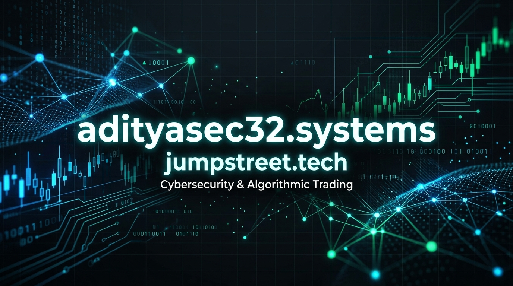

  

  
  
  
  

 

## 🛡️ Executive Summary

I am a **Cybersecurity Engineer** and **Systems Architect** specializing in Critical National Infrastructure (CNI) surveillance, State Network Operations (NOC), purple-teaming security defense, and high-throughput automated execution engines. 

- 🏛️ **Government & CNI Operations**: Architect of state-wide telemetry, perimeter hardening, and SLA surveillance across 38 district routers and State Data Centre (SDC) e-governance backbones.
- ⚡ **State NOC Surveillance Grid**: Engineered autonomous Python recovery watchdogs and low-latency Node.js synthetic heartbeat engines with zero sovereign data egress.
- 🐶 **CyberKarma Initiative**: Founder & Architect of [CyberKarma](https://cyberkarma.me) — an interactive cybersecurity trivia platform that funds real-world stray animal feeding & welfare drives.
- 📈 **Low-Latency Systems**: Developer of sub-millisecond execution logic, Windows Cloud VM architectures, and automated trading watchdogs.

---

## 🚀 Featured Engineering Operations & Case Studies

### 🛡️ [State NOC Telemetry Engine](https://adityasec32.systems/projects#uptime-kuma-state-noc)
> **Mission-Critical State WAN & E-Governance Infrastructure Surveillance**
- **Host Infrastructure:** Deployed on dedicated on-premise State NOC telemetry node (Node.js Kernel).
- **Autonomous Watchdog:** 2-minute recurring Python failover daemon (`portal_monitor_daemon.py`) ensuring zero downtime, automatic crash mitigation, and intranet status dispatch.
- **Air-Gapped Sovereign Defense:** Strictly zero external network egress — ensuring 100% telemetry confidentiality within the State WAN boundary.
- **Official Watermarked Dossier:** [Download Sanitized Technical Dossier (PDF)](https://adityasec32.systems/docs/Bihar_State_NOC_Uptime_Kuma_Executive_Dossier.pdf) • [Kernel Architecture (PDF)](https://adityasec32.systems/docs/Bihar_NOC_NodeJS_Kernel_Architecture.pdf) • [WAN Timing Matrix (PDF)](https://adityasec32.systems/docs/Bihar_State_NOC_Ping_Timing_and_Architecture.pdf)

### 🔒 [CDAC / CERT-In Compliance Automation Engine](https://adityasec32.systems/projects#cert-in-compliance)
> **750+ Endpoint Automated Regulatory Hardening**
- Engineered a PowerShell and Python automation framework executing 120+ baseline configuration and regulatory security checks mapped to NIST CSF & ISO 27001 across 750+ government endpoints via KACE UEM.
- Reduced manual compliance audit cycles by 60% with automated USB lockout enforcement and registry hardening.

### 🌐 [CyberKarma Initiative (cyberkarma.me)](https://cyberkarma.me)
> **Gamified Cybersecurity Trivia & Real-World Stray Animal Welfare**
- Interactive security education platform converting quiz scores and ad-supported engagement into verified daily meals for stray shelter animals.
- **Tech Stack:** Next.js Static Export, Tailwind CSS, Responsive PWA, Structured SEO Schema.

### ⚡ [Jumpstreet Trading Technology (jumpstreet.tech)](https://jumpstreet.tech)
> **Sub-Millisecond Execution Infrastructure & Cloud Hosting**
- High-availability Windows cloud VM provisioning pre-configured with automated watchdog daemons and proprietary sub-millisecond signal algorithms.

---

## 🛠️ Technical Arsenal

  <table border="0">
    <tr>
      <td align="center" width="96">
         
        <b>Core Stack & Platforms</b>
      </td>
    </tr>
  </table>

### Security & Infrastructure Hardening
State WAN Hardening • Purple Teaming • Threat Simulation • NOC Telemetry • CERT-In Baselines • Zero Trust Architecture • Firewall & Route Flap Mitigation • Incident Response

### Systems & Automation
Python Daemons • Bash & PowerShell Automation • Node.js Kernels • SQLite WAL • Docker & CI/CD Pipelines • Windows Server Administration • Socket.IO Streaming

---

## 📊 GitHub Analytics

  
  

---

## 📬 Encrypted & Professional Comms

- 🌐 **Primary Web Portal**: [adityasec32.systems](https://adityasec32.systems)
- 📂 **Case Studies & Projects**: [adityasec32.systems/projects](https://adityasec32.systems/projects)
- 🐾 **CyberKarma Game**: [cyberkarma.me](https://cyberkarma.me)
- ⚡ **Jumpstreet Portal**: [jumpstreet.tech](https://jumpstreet.tech)
- ✉️ **Direct Email**: [adityasec32@gmail.com](mailto:adityasec32@gmail.com)

  <i>Engineered for Reliability • Secured by Design • Driven by Sovereign Defense & Impact</i>

